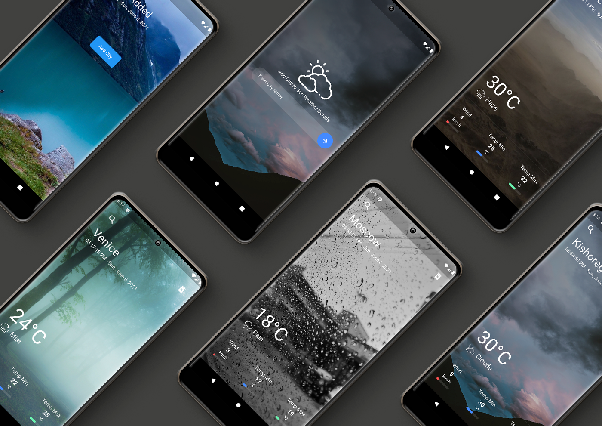
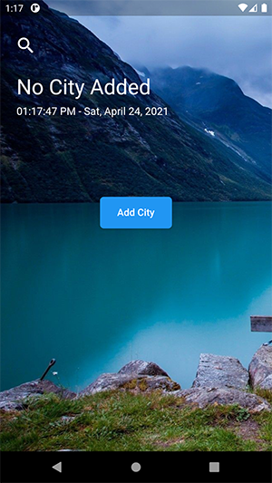
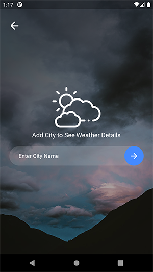
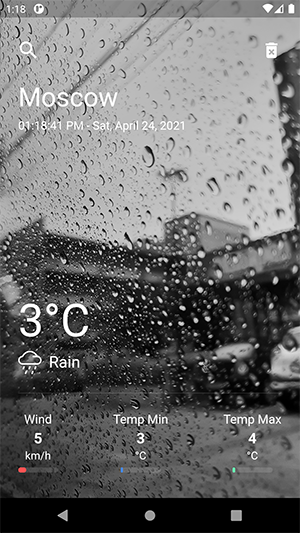
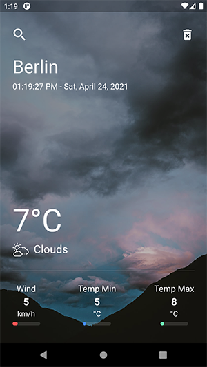
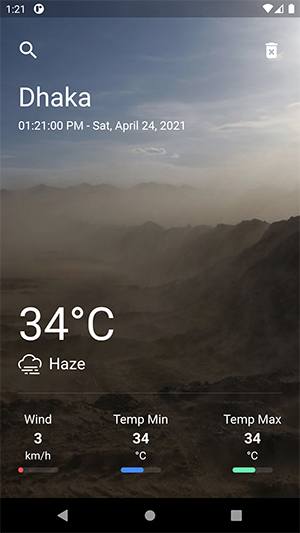
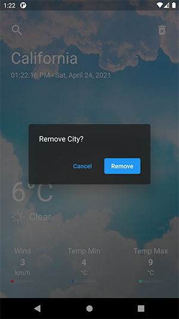

# Neo Weather ☀️🌧️

<div align="center">

A beautiful and modern weather application built with **Flutter** and **Dart** for Android & iOS devices. Get real-time weather information with an intuitive and visually appealing interface.



[](https://github.com/Rezuanul-Islam-Fahim/neo_weather/stargazers) 
[](https://github.com/Rezuanul-Islam-Fahim/neo_weather/network/members) 
[](https://github.com/Rezuanul-Islam-Fahim/neo_weather/watchers) 
[](https://github.com/Rezuanul-Islam-Fahim/neo_weather/blob/master/LICENSE)
[](https://flutter.dev)
[](https://dart.dev)

[Live Preview](https://appetize.io/app/bofepnohvuajbs5ijngokyusui) • [Report Bug](https://github.com/Rezuanul-Islam-Fahim/neo_weather/issues) • [Request Feature](https://github.com/Rezuanul-Islam-Fahim/neo_weather/issues)

</div>

---

## 📱 Screenshots

<div align="center">
     
</div>

---

## ✨ Features

- 📱 **Cross-Platform Support** - Seamlessly runs on Android & iOS
- 🎨 **Beautiful UI/UX** - Modern, clean, and intuitive design
- 🌈 **Dynamic Backgrounds** - Context-aware backgrounds that change based on weather conditions
- 🔍 **Smart City Search** - Search for any city worldwide with form validation
- 🌡️ **Real-Time Weather Data** - Current temperature, humidity, wind speed, and more
- 🔄 **Pull to Refresh** - Easily update weather information with a simple pull gesture
- ⏰ **Live Digital Clock** - Real-time clock display on the home screen
- 🎯 **Dynamic Weather Icons** - Weather status icons that adapt to current conditions
- 💾 **Persistent Storage** - Saves your last searched location
- 🚀 **Smooth Performance** - Optimized for fast loading and smooth animations
- 🌐 **OpenWeather API** - Powered by reliable weather data from OpenWeather

---

## 🛠️ Built With

- **[Flutter](https://flutter.dev/)** - UI framework
- **[Dart](https://dart.dev/)** - Programming language
- **[OpenWeather API](https://openweathermap.org/api)** - Weather data provider
- **[HTTP](https://pub.dev/packages/http)** - API communication
- **[Flutter SVG](https://pub.dev/packages/flutter_svg)** - SVG rendering
- **[Shared Preferences](https://pub.dev/packages/shared_preferences)** - Local data storage
- **[Flutter DotEnv](https://pub.dev/packages/flutter_dotenv)** - Environment variable management
- **[Timer Builder](https://pub.dev/packages/timer_builder)** - Real-time clock functionality
- **[Intl](https://pub.dev/packages/intl)** - Internationalization and date formatting

---

## 📋 Prerequisites

Before you begin, ensure you have the following installed:

- **Flutter SDK** (3.5.0 or higher) - [Installation Guide](https://docs.flutter.dev/get-started/install)
- **Dart SDK** (3.5.0 or higher) - Comes with Flutter
- **Android Studio** / **Xcode** (for iOS development on macOS)
- **Git** - [Download](https://git-scm.com/downloads)
- **OpenWeather API Key** - [Get Free API Key](https://openweathermap.org/api)

---

## 🚀 Getting Started

### 1. Clone the Repository

```bash
git clone https://github.com/Rezuanul-Islam-Fahim/neo_weather.git
cd neo_weather
```

### 2. Install Dependencies

```bash
flutter pub get
```

### 3. Configure API Key

Create a `.env` file in the root directory of the project:

```bash
# .env
OPENWEATHER_API_KEY=your_api_key_here
```

> **Note:** Replace `your_api_key_here` with your actual OpenWeather API key. You can get a free API key by signing up at [OpenWeather](https://openweathermap.org/api).

### 4. Run the App

#### For Android:
```bash
flutter run
```

#### For iOS (macOS only):
```bash
flutter run
```

#### Build Release APK (Android):
```bash
flutter build apk --release
```

#### Build Release App Bundle (Android):
```bash
flutter build appbundle --release
```

#### Build for iOS:
```bash
flutter build ios --release
```

---

## 📂 Project Structure

```
neo_weather/
├── android/              # Android native code
├── ios/                  # iOS native code
├── lib/
│   ├── main.dart        # Application entry point
│   ├── components/      # Reusable UI components
│   │   ├── homeScreen/
│   │   └── searchScreen/
│   └── screens/         # App screens
│       ├── homeScreen.dart
│       └── searchScreen.dart
├── assets/
│   ├── icons/           # SVG and image icons
│   └── images/          # Background images
├── screenshots/         # App screenshots
├── test/                # Unit and widget tests
├── .env                 # Environment variables (create this)
├── pubspec.yaml         # Dependencies and assets
└── README.md            # This file
```

---

## 🔧 Configuration

### API Configuration

The app uses OpenWeather API for fetching weather data. Make sure to:

1. Sign up at [OpenWeather](https://openweathermap.org/api)
2. Generate an API key
3. Add the API key to your `.env` file
4. Restart the app

### Supported Weather Conditions

The app supports dynamic backgrounds and icons for:
- ☀️ Clear/Sunny
- ⛅ Partly Cloudy
- ☁️ Cloudy/Overcast
- 🌧️ Rainy
- ⛈️ Thunderstorm
- 🌨️ Snowy
- 🌫️ Foggy/Misty

---

## 🧪 Testing

Run the test suite:

```bash
flutter test
```

Run tests with coverage:

```bash
flutter test --coverage
```

---

## 🔄 Continuous Integration & Deployment

This project uses **GitHub Actions** for automated building, testing, and deployment.

### Automated Workflow

Every pull request to the `master` branch automatically:
- ✅ Analyzes code quality with `flutter analyze`
- 🏗️ Builds a release APK
- 📦 Uploads the APK as a downloadable artifact (30-day retention)
- 🔐 Generates SHA256 checksum for integrity verification
- 🌐 Deploys to [Appetize.io](https://appetize.io) for browser-based testing
- 💬 Posts build results and download links directly to the PR

### Download & Test Latest Build

- **📱 Live Preview**: Test the app instantly in your browser on [Appetize.io](https://appetize.io/app/bofepnohvuajbs5ijngokyusui) (no installation required!)
- **📦 Download APK**: Get the latest APK from [GitHub Actions Artifacts](https://github.com/Rezuanul-Islam-Fahim/neo_weather/actions) (navigate to any workflow run)

### Build Features

- **Smart Caching**: Dependencies are cached for faster subsequent builds (~2.5x speedup)
- **Version Tracking**: APKs are automatically named with version from `pubspec.yaml` (e.g., `neo_weather-1.1.1+7.apk`)
- **Direct Downloads**: Get direct download links for built APKs in PR comments
- **Live Preview Links**: Appetize.io URLs provided in PR comments and workflow summaries
- **Security**: SHA256 checksums included for verifying APK integrity
- **Smart Updates**: Automatically updates existing Appetize app or creates new one on first run

For more details on the workflow architecture, see [`.github/ARCHITECTURE.md`](.github/ARCHITECTURE.md).

---

## 🤝 Contributing

Contributions are what make the open-source community such an amazing place to learn, inspire, and create. Any contributions you make are **greatly appreciated**.

1. Fork the Project
2. Create your Feature Branch (`git checkout -b feature/AmazingFeature`)
3. Commit your Changes (`git commit -m 'Add some AmazingFeature'`)
4. Push to the Branch (`git push origin feature/AmazingFeature`)
5. Open a Pull Request

---

## 🐛 Known Issues

- None at the moment

If you find any bugs or issues, please [report them here](https://github.com/Rezuanul-Islam-Fahim/neo_weather/issues).

---

## 📝 Roadmap

- [ ] Add weather forecast for multiple days
- [ ] Implement location-based weather detection
- [ ] Add weather alerts and notifications
- [ ] Support for multiple languages
- [ ] Dark/Light theme toggle
- [ ] Weather widgets
- [ ] Hourly forecast
- [ ] Weather maps

---

## 💡 Inspiration

This project was created to demonstrate modern Flutter development practices and provide a beautiful, functional weather application that can serve as a learning resource for Flutter developers.

---

## 📄 License

This project is licensed under the MIT License - see the [LICENSE](LICENSE) file for details.

```
MIT License

Copyright (c) 2021 Rezuanul Islam Fahim

Permission is hereby granted, free of charge, to any person obtaining a copy
of this software and associated documentation files (the "Software"), to deal
in the Software without restriction, including without limitation the rights
to use, copy, modify, merge, publish, distribute, sublicense, and/or sell
copies of the Software, and to permit persons to whom the Software is
furnished to do so, subject to the following conditions:

The above copyright notice and this permission notice shall be included in all
copies or substantial portions of the Software.

THE SOFTWARE IS PROVIDED "AS IS", WITHOUT WARRANTY OF ANY KIND, EXPRESS OR
IMPLIED, INCLUDING BUT NOT LIMITED TO THE WARRANTIES OF MERCHANTABILITY,
FITNESS FOR A PARTICULAR PURPOSE AND NONINFRINGEMENT. IN NO EVENT SHALL THE
AUTHORS OR COPYRIGHT HOLDERS BE LIABLE FOR ANY CLAIM, DAMAGES OR OTHER
LIABILITY, WHETHER IN AN ACTION OF CONTRACT, TORT OR OTHERWISE, ARISING FROM,
OUT OF OR IN CONNECTION WITH THE SOFTWARE OR THE USE OR OTHER DEALINGS IN THE
SOFTWARE.
```

---

## 👤 Author

**Rezuanul Islam Fahim**

- GitHub: [@Rezuanul-Islam-Fahim](https://github.com/Rezuanul-Islam-Fahim)

---

## 🌟 Show Your Support

Give a ⭐️ if this project helped you or if you like it!

---

## 🙏 Acknowledgments

- [OpenWeather](https://openweathermap.org/) for providing the weather API
- [Flutter](https://flutter.dev/) team for the amazing framework
- All contributors and supporters of this project

---

<div align="center">

**Made with ❤️ using Flutter**

</div>